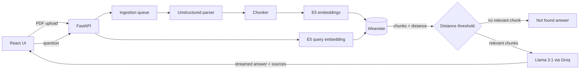

# RAG Document Q&A

[](https://github.com/EmirUsta/rag-document-qa/actions/workflows/ci.yml)

A self-hosted question-answering app over your own PDF documents. Upload PDFs, ask questions in a chat, and get answers grounded only in the uploaded documents, with the source file and page for every answer.

I run it on my home server (Proxmox LXC + Docker Compose).

## Features

- PDF upload with a background ingestion queue and live progress
- Answers streamed token by token, with source file and page numbers
- Strict grounding: if the documents do not contain the answer, the app says so instead of guessing
- Per-session chat history, document list and delete
- Multilingual embeddings (works well with Turkish documents)

## Stack

| Layer | Tech |
|---|---|
| Backend | Python, FastAPI, LangChain |
| Vector DB | Weaviate |
| Embeddings | `intfloat/multilingual-e5-small` (sentence-transformers) |
| LLM | Llama 3.1 8B via Groq API |
| PDF parsing | Unstructured |
| Frontend | React, Vite, Tailwind, served by nginx |
| Deployment | Docker Compose |

## How it works



1. **Ingestion:** an uploaded PDF is validated (extension and magic bytes), parsed with Unstructured, split into chunks, embedded with E5 (`passage:` prefix) and written to Weaviate with only the metadata the app needs (document id, file name, page).
2. **Retrieval:** the question is embedded (`query:` prefix) and searched with a raw cosine `near_vector` query, so real distances are available.
3. **Grounding filter:** chunks farther than a distance threshold are dropped. If nothing is left, the app answers "not found" without calling the LLM.
4. **Generation:** the remaining chunks and the chat history go to the LLM with a strict system prompt and the answer is streamed back. Sources are hidden when the model itself says the answer is not in the documents.

## Run

```bash
cp .env.example .env
docker compose up -d --build
```

Then open `http://localhost:1234`. You need a Groq API key in `.env`.

## Design notes

- **Single ingestion worker:** parallel PDF jobs writing to the shared Weaviate batch context caused race conditions. One worker gives a simple FIFO queue and `run_in_executor` keeps the event loop free.
- **Scanned PDFs:** the fast parser does no OCR. A PDF with no extractable text is reported as an error instead of a "completed" document that can never be found.
- **Repetition loops:** greedy decoding (`temperature=0`) made long answers repeat the same paragraphs. A small parameter sweep picked `temperature=0.4`, `frequency_penalty=1.5`, `presence_penalty=1.0`; higher penalties brought the loops back. `max_tokens` is a hard upper bound.
- **Tabs keep state:** chat and documents tabs are hidden with CSS instead of unmounted, so a live conversation is not lost when switching tabs.
- **Session id fallback:** `crypto.randomUUID()` only exists in secure contexts, so plain HTTP access over LAN uses a manual fallback.
- **Upload progress survives refresh:** running jobs are fetched again on page load and polling resumes.
